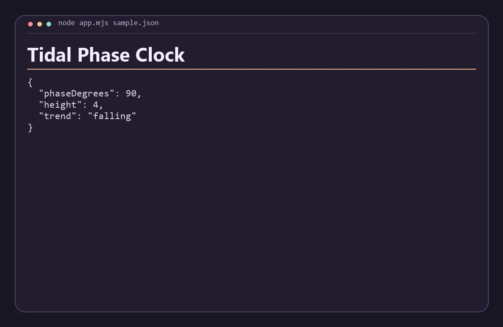

# Tidal Phase Clock

Explore phase and modeled height in an idealized repeating tide cycle.



## Run

Install Node.js 22 or newer. Run these commands from the repository root.

```sh
node app.mjs sample.json
```

Replace `sample.json` with a JSON file following the same structure. The app prints a JSON report to standard output.

Supply elapsed and period in the same unit, with elapsed zero at modeled high tide. This uses a single cosine, with synthetic inputs and no live tide data.

## Verify

Run `python check.py` with Python 3.11 or newer after the build step when applicable. The check verifies the bundled scenario and confirms that an invalid input returns an error.
